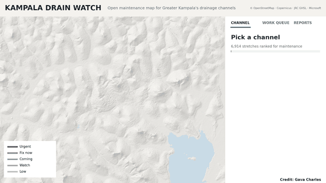

# Kampala Drain Watch

**Open maintenance map for Greater Kampala's drainage channels.**

👉 **Open the map: https://gavacharles.github.io/kampala-drain-watch/**

Every stretch of drainage channel in Greater Kampala that carries real flow (6,914 stretches, about 470 km) is ranked for maintenance from open data.

- **Hover or tap a drain** to see its name, catchment and maintenance priority.
- **Click a drain** to see why it ranks where it does: buildings within 15 m of the channel, homes on low ground, culverts and bridges, dump sites nearby, wetland left, and paving added upstream since 1990.
- **Follow the water:** step upstream or downstream, trace where a drain's water goes, or light up everything that drains into it.
- **Work queue:** the stretches that most need attention, filtered by catchment and work class (Urgent, Fix now, Coming, Watch).
- **Search** for any drain or neighbourhood.

## How the scores work

- **Maintenance priority** is the average percentile rank of six present-day pressures: runoff load (upstream area × paving), culverts and bridges, mapped dump sites and markets nearby, buildings within 15 m of the channel, buildings on low ground within 150 m, and how little wetland is left. Checked against 45 reported flood hotspots: AUC 0.73.
- **Emerging risk** combines growth since 1990 in upstream paving and in building on the valley floor. Change in 1975–2000 predicted where valley floors were built over in 2000–2020 (AUC 0.79).
- **Work class:** Urgent (high now and worsening), Fix now (high, stable), Coming (rising, not yet high), Watch (middle on both).

Drains without a name on OpenStreetMap are named after the nearest neighbourhood.

## Field reports

This public site shows the map and rankings. Shared field reports (blockages, dumping, flooding, encroachment, works done) are collected in the team version used by maintenance crews.

## Data sources

Channels, culverts, waste points and places: © OpenStreetMap contributors (ODbL) · buildings: Microsoft Global ML Building Footprints (ODbL) · built-up and population: JRC Global Human Settlement Layer R2023A · relief: Copernicus GLO-30 DEM · wetland: ESA WorldCover 2021 · radar: ESA Copernicus Sentinel-1 · flood hotspots: KCCA/NEMA lists, Ugandan news and local reports (approximate locations).

Scores are screening values for prioritising inspection. They are not a hydraulic model or a flood forecast.

## Credit and licence

Analysis and map by **Gava Charles**. Text, graphics and scores are licensed under [CC BY 4.0](LICENSE): free to share and adapt with credit to "Gava Charles". The underlying OpenStreetMap and Microsoft building data remain under ODbL.
