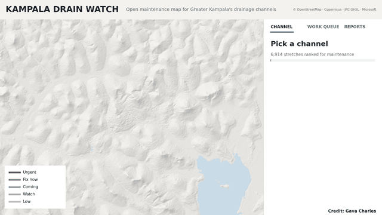

# kampala-drain-watch

Static GitHub Pages site for Kampala Drain Watch, an open maintenance map of Greater Kampala's drainage channels: maintenance priority and emerging-risk scores, flow tracing, a work queue and search. Live at https://gavacharles.github.io/kampala-drain-watch/

## Contents

| File | What it is |
|---|---|
| `index.html` | The map application |
| `segments.json` | Channel stretches with scores and attributes |
| `channel_labels.json`, `system_labels.json`, `places.json`, `hotspots.json` | Labels and map layers |
| `basemap_light.png`, `basemap_dark.png` | Basemaps |
| `demo.gif` | Demo animation |
| `LICENSE` | CC BY 4.0 |
| `.nojekyll` | Serve files as they are on GitHub Pages |

The site is a copy of `tool/` in the uganda-rainfall-climate repository, where the scores are computed. To view locally, serve the folder (`python -m http.server`) and open http://localhost:8000.

## Data sources

© OpenStreetMap contributors (ODbL) for channels, culverts, waste points and places; Microsoft Global ML Building Footprints (ODbL); JRC Global Human Settlement Layer R2023A; Copernicus GLO-30 DEM; ESA WorldCover 2021; Copernicus Sentinel radar. Scores are screening values for prioritising inspection, not a hydraulic model or flood forecast.

## Credit and licence

Analysis and map by Gava Charles. Text, graphics and scores are licensed under [CC BY 4.0](LICENSE): free to share and adapt with credit to "Gava Charles". The underlying OpenStreetMap and Microsoft building data remain under ODbL.
